# P.R.I.M.E. Master Task Board & Dependency Graph

This document serves as the single source of truth for task tracking, execution sequencing, dependencies, and acceptance criteria across all phases of **P.R.I.M.E.**.

---

## 1. Task ID Scheme & Convention

All tasks follow a deterministic and stable identifier format:

$$\text{TASK-}\{\text{PHASE}\}\text{-}\{\text{CATEGORY}\}\text{-}\{\text{INDEX}\}$$

* **PHASE**: Two-digit phase code (`00` through `07`).
* **CATEGORY**:
  - `DOC`: Documentation, specifications, and architecture records.
  - `ENV`: Environment, scaffolding, dependency setup, and hardware checks.
  - `CORE`: Core backend logic, Ollama client, and configuration.
  - `AGENT`: Multi-agent orchestration, prompts, and message routing.
  - `MEM`: Persistent memory, SQLite schemas, and vector stores.
  - `RAG`: Chunking, indexing, embedding, and semantic retrieval.
  - `TOOL`: Computer control, sandboxes, safety verification, and HITL.
  - `VOICE`: STT, TTS, VAD, and real-time audio pipeline.
  - `UI`: Frontend React dashboard, WebSockets, and audio visualizer.
  - `TEST`: Unit tests, integration tests, and benchmarks.
* **INDEX**: Two-digit sequence number (e.g., `01`, `02`).

---

## 2. Task Lifecycle & Statuses

| Status | Meaning |
| :--- | :--- |
| `BACKLOG` | Defined in roadmap, waiting for predecessor phases. |
| `PLANNED` | Scoped and prioritized for the immediate next phase. |
| `IN_PROGRESS` | Currently being actively worked on. |
| `BLOCKED` | Cannot proceed due to unmet dependencies or technical blockers. |
| `REVIEW` | Code implemented, awaiting automated tests and verification. |
| `DONE` | Acceptance criteria verified, tests passing, documented in CHANGELOG. |

---

## 3. Master Dependency Graph

```mermaid
flowchart TD
    subgraph Phase00["Phase 00: Architecture & Documentation"]
        T00_1["TASK-00-DOC-01: System Documentation"] --> T00_2["TASK-00-DOC-02: Agent Architecture Spec"]
        T00_2 --> T00_3["TASK-00-DOC-03: ADRs & Decision Records"]
        T00_3 --> T00_4["TASK-00-DOC-04: Task Graph & Phase Blueprint"]
    end

    subgraph Phase01["Phase 01: Core Backend & Ollama Runtime"]
        T01_1["TASK-01-ENV-01: Python Scaffolding & Hardware Probe"]
        T01_2["TASK-01-CORE-02: Ollama Async Client & Health Check"]
        T01_3["TASK-01-CORE-03: FastAPI App & WebSocket Gateway"]
        T01_1 --> T01_2 --> T01_3
    end

    subgraph Phase02["Phase 02: Multi-Agent Protocol"]
        T02_1["TASK-02-AGENT-01: Master Orchestrator Engine"]
        T02_2["TASK-02-AGENT-02: Specialist Agent Base Classes"]
        T02_3["TASK-02-AGENT-03: Inter-Agent JSON-RPC Router"]
        T02_1 --> T02_2 --> T02_3
    end

    subgraph Phase03["Phase 03: RAG & Persistent Memory"]
        T03_1["TASK-03-MEM-01: SQLite Schema & WAL Engine"]
        T03_2["TASK-03-RAG-02: LanceDB Embedded Vector Store"]
        T03_3["TASK-03-RAG-03: Hybrid Retrieval & Citation Engine"]
        T03_1 --> T03_2 --> T03_3
    end

    subgraph Phase04["Phase 04: Controlled Computer Tools"]
        T04_1["TASK-04-TOOL-01: 3-Tier Security & Sandbox Manager"]
        T04_2["TASK-04-TOOL-02: File System & System Telemetry Tools"]
        T04_3["TASK-04-TOOL-03: HITL Confirmation Protocol"]
        T04_1 --> T04_2 --> T04_3
    end

    subgraph Phase05["Phase 05: Local Voice Pipeline"]
        T05_1["TASK-05-VOICE-01: Silero VAD Voice Detection"]
        T05_2["TASK-05-VOICE-02: Faster-Whisper CPU/GPU STT"]
        T05_3["TASK-05-VOICE-03: Piper Local TTS Engine"]
        T05_1 --> T05_2 --> T05_3
    end

    subgraph Phase06["Phase 06: React Dashboard & Telemetry"]
        T06_1["TASK-06-UI-01: React + Vite + Tailwind Scaffold"]
        T06_2["TASK-06-UI-02: Streaming Agent Feed & Thought Visualizer"]
        T06_3["TASK-06-UI-03: HITL Action Approval Modal & Audio Visualizer"]
        T06_1 --> T06_2 --> T06_3
    end

    subgraph Phase07["Phase 07: Integration & Hardening"]
        T07_1["TASK-07-TEST-01: E2E Pipeline Integration Tests"]
        T07_2["TASK-07-TEST-02: Offline & Airgap Verification"]
        T07_3["TASK-07-TEST-03: Hardware Budget & Stress Testing"]
        T07_1 --> T07_2 --> T07_3
    end

    Phase00 --> Phase01
    Phase01 --> Phase02
    Phase02 --> Phase03
    Phase02 --> Phase04
    Phase01 --> Phase05
    Phase02 --> Phase06
    Phase03 --> Phase07
    Phase04 --> Phase07
    Phase05 --> Phase07
    Phase06 --> Phase07
```

---

## 4. Phase-by-Phase Task Catalog

### Phase 00: Architecture, Documentation & Groundwork (Status: DONE)

| Task ID | Title | Status | Predecessor | Acceptance Criteria |
| :--- | :--- | :---: | :---: | :--- |
| `TASK-00-DOC-01` | System Vision & README Setup | **DONE** | None | Full README.md with vision, hardware matrix, tech stack. |
| `TASK-00-DOC-02` | Multi-Agent Specification | **DONE** | `TASK-00-DOC-01` | AGENTS.md specifying Master + 4 Specialists, prompts, tools. |
| `TASK-00-DOC-03` | Architectural Decision Records | **DONE** | `TASK-00-DOC-01` | DECISIONS.md with ADR-001 through ADR-009. |
| `TASK-00-DOC-04` | Task Board, DAG & Phase Blueprint | **DONE** | `TASK-00-DOC-03` | TASKS.md, PROJECT_STATE.md, CHANGELOG.md, docs/phases/PHASE_00.md. |

---

### Phase 01: Core Backend & SQLite Database (Status: DONE)

| Task ID | Title | Status | Predecessor | Acceptance Criteria |
| :--- | :--- | :---: | :---: | :--- |
| `TASK-01-ENV-01` | Python Virtual Env & Scaffolding | **DONE** | `TASK-00-DOC-04` | Python 3.11+ venv created, backend directory scaffolded, locked dependencies in `requirements.txt`. |
| `TASK-01-CORE-01`| SQLite WAL Database Manager | **DONE** | `TASK-01-ENV-01` | SQLite database manager with WAL mode, schema version tracking, and baseline tables. |
| `TASK-01-CORE-02`| FastAPI App Factory & Health Probe | **DONE** | `TASK-01-CORE-01` | FastAPI app starts on port 8000, provides `/health` liveness and readiness probe with DB state. |
| `TASK-01-CORE-03`| Structured Logging & Configuration | **DONE** | `TASK-01-CORE-02` | JSON and text structured log formatters and Pydantic Settings with env var overrides. |
| `TASK-01-TEST-01`| Phase 01 Pytest Suite | **DONE** | `TASK-01-CORE-03` | Automated unit tests for config, database, health, and logging with 49 tests passing. |

---

### Phase 02: Local AI Runtime Integration (Status: DONE)

| Task ID | Title | Status | Predecessor | Acceptance Criteria |
| :--- | :--- | :---: | :---: | :--- |
| `TASK-02-CORE-01` | Async Ollama Client | **DONE** | `TASK-01-CORE-02` | Async HTTP client connecting to `127.0.0.1:11434`, tests connection and model availability. |
| `TASK-02-CORE-02` | Hardware Safety Guardrails | **DONE** | `TASK-02-CORE-01` | Rejects models exceeding 4GB VRAM envelope (>8B parameters) with HTTP 422. Never auto-pulls large models. |
| `TASK-02-CORE-03` | Chat Completion & SSE Streaming | **DONE** | `TASK-02-CORE-02` | `/api/v1/ollama/chat` supporting non-streaming and Server-Sent Events (SSE) streaming. |
| `TASK-02-CORE-04` | Real-Model Smoke Test & Offline Probe | **DONE** | `TASK-02-CORE-03` | Standalone script `smoke_test_ollama.py` verifying real Ollama connection and graceful offline handling. |
| `TASK-02-TEST-01` | Phase 02 Pytest Suite | **DONE** | `TASK-02-CORE-04` | 24 unit & integration tests covering client, error mappings (503, 504, 404, 422), and API routes. |

---

### Phase 03: Multi-Agent Orchestration Protocol (Status: PLANNED)

| Task ID | Title | Status | Predecessor | Acceptance Criteria |
| :--- | :--- | :---: | :---: | :--- |
| `TASK-03-AGENT-01` | Base Specialist Agent Class | `PLANNED` | `TASK-02-CORE-03` | Abstract agent base class handling prompt assembly, tool schema parsing, and execution loop. |
| `TASK-03-AGENT-02` | Master Orchestrator Dispatcher | `BACKLOG` | `TASK-03-AGENT-01` | Master Agent classifies user query and dispatches typed JSON payloads to appropriate specialists. |
| `TASK-03-AGENT-03` | Four Specialist Agent Implementations | `BACKLOG` | `TASK-03-AGENT-02` | Implement Research, System, Code, and Personal agent classes with domain prompts. |
| `TASK-03-AGENT-04` | Loop Detection & Turn Guardrail | `BACKLOG` | `TASK-03-AGENT-03` | Orchestrator halts repeated tool loops and enforces max 5-turn depth per subtask. |

---

### Phase 03: Local Knowledge (RAG) & Persistent Memory (Status: BACKLOG)

| Task ID | Title | Status | Predecessor | Acceptance Criteria |
| :--- | :--- | :---: | :---: | :--- |
| `TASK-03-MEM-01` | SQLite WAL Memory Store | `BACKLOG` | `TASK-01-CORE-03` | SQLite DB schema for conversation sessions, user preferences, and audit logs. |
| `TASK-03-RAG-01` | Embedded LanceDB Integration | `BACKLOG` | `TASK-03-MEM-01` | In-process LanceDB database initialized, table schemas created for document chunks. |
| `TASK-03-RAG-02` | Local Embedding Pipeline | `BACKLOG` | `TASK-03-RAG-01` | Embedding generator running `bge-small-en-v1.5` on CPU/INT8 with <50ms chunk encoding. |
| `TASK-03-RAG-03` | Hybrid Retrieval & Citation Engine | `BACKLOG` | `TASK-03-RAG-02` | Combined dense vector + BM25 keyword search with source file & line citation tagging. |

---

### Phase 04: Controlled Computer Tools & Safety Sandbox (Status: BACKLOG)

| Task ID | Title | Status | Predecessor | Acceptance Criteria |
| :--- | :--- | :---: | :---: | :--- |
| `TASK-04-TOOL-01` | 3-Tier Tool Security Framework | `BACKLOG` | `TASK-02-AGENT-01` | Tool decorator enforcing Tier 1 (auto), Tier 2 (logged), Tier 3 (HITL approval). |
| `TASK-04-TOOL-02` | Safe File System Tools | `BACKLOG` | `TASK-04-TOOL-01` | Scoped file read/write/list operations restricted to permitted directories. |
| `TASK-04-TOOL-03` | System Telemetry & Process Tools | `BACKLOG` | `TASK-04-TOOL-01` | Read CPU/RAM/VRAM stats, list active processes, launch approved applications. |
| `TASK-04-TOOL-04` | HITL WebSocket Confirmation Flow | `BACKLOG` | `TASK-04-TOOL-03` | Backend suspends execution and requests user approval over WebSocket before Tier 3 actions. |

---

### Phase 05: Local Voice Pipeline (STT / TTS / VAD) (Status: BACKLOG)

| Task ID | Title | Status | Predecessor | Acceptance Criteria |
| :--- | :--- | :---: | :---: | :--- |
| `TASK-05-VOICE-01`| Silero VAD Integration | `BACKLOG` | `TASK-01-CORE-03` | Low-power voice activity detection streaming audio frames on CPU. |
| `TASK-05-VOICE-02`| Faster-Whisper Local STT | `BACKLOG` | `TASK-05-VOICE-01` | Transcribes audio locally using quantized `base.en` with <500ms latency. |
| `TASK-05-VOICE-03`| Piper Neural TTS Integration | `BACKLOG` | `TASK-05-VOICE-02` | Synthesizes agent voice replies in real time with high naturalness and zero VRAM impact. |

---

### Phase 06: React Dashboard & Telemetry Frontend (Status: BACKLOG)

| Task ID | Title | Status | Predecessor | Acceptance Criteria |
| :--- | :--- | :---: | :---: | :--- |
| `TASK-06-UI-01` | React + Vite + Tailwind Scaffold | `BACKLOG` | `TASK-01-CORE-03` | Modern, responsive dark-mode dashboard with connection indicator. |
| `TASK-06-UI-02` | Streaming Chat & Thought Feed | `BACKLOG` | `TASK-06-UI-01` | Real-time token streaming, agent status pills, thought accordion blocks. |
| `TASK-06-UI-03` | HITL Confirmation Modal | `BACKLOG` | `TASK-06-UI-02` | Interactive modal presenting action previews, parameters, and Approve/Reject buttons. |
| `TASK-06-UI-04` | Audio Visualizer & Voice Toggle | `BACKLOG` | `TASK-06-UI-03` | WebAudio live waveform visualizer with push-to-talk and voice activation toggles. |

---

### Phase 07: System Hardening, Integration & Benchmark (Status: BACKLOG)

| Task ID | Title | Status | Predecessor | Acceptance Criteria |
| :--- | :--- | :---: | :---: | :--- |
| `TASK-07-TEST-01` | End-to-End Multi-Agent Test | `BACKLOG` | All Phases | Automated test verifying user query -> Master -> Specialist -> Tool -> Response flow. |
| `TASK-07-TEST-02` | 100% Offline Airgap Verification | `BACKLOG` | `TASK-07-TEST-01` | System runs without network interface enabled; zero DNS or external IP calls. |
| `TASK-07-TEST-03` | Hardware VRAM/RAM Stress Test | `BACKLOG` | `TASK-07-TEST-02` | Sustained execution over 1 hour with VRAM peak verified <= 3.5 GB and RAM <= 12 GB. |

---

## 5. Immediate Next Task Focus: Phase 01

The immediate task ready for implementation is **`TASK-01-ENV-01`**.

### Execution Spec for `TASK-01-ENV-01`
* **Objective**: Create Python virtual environment, directory scaffold, and dependency manifests.
* **Pre-conditions**: Phase 00 complete (verified).
* **Target Artifacts**:
  1. `backend/requirements.txt`
  2. `backend/app/main.py`
  3. `backend/app/core/config.py`
  4. `backend/app/core/hardware.py`
* **Acceptance Test**: Run `python backend/app/core/hardware.py` and verify it reports available RAM, GPU, and VRAM correctly.
